# Organizador

Sistema pessoal de organização da casa: afazeres, rotina, mercado, despensa, pets, finanças e arquivos.

Roda num computador de casa (o "servidor") e é acessado pelos outros aparelhos da mesma rede Wi-Fi.
Não há deploy em nuvem e nada fica exposto para a internet. Funciona sem internet.

## Stack

| Camada | Tecnologia |
|---|---|
| API | Python 3.12, FastAPI, SQLAlchemy 2, Alembic, Pydantic v2 |
| Banco | PostgreSQL 16 |
| Arquivos | [Garage](https://garagehq.deuxfleurs.fr/) (armazenamento compatível com S3) |
| Frontend | React, TypeScript, Vite, Tailwind *(Fase 4)* |
| Infra | Docker Compose, Nginx/Caddy *(Fase 5)*, GitHub Actions |

## Por que Garage e não MinIO?

O plano original usava o MinIO. Em 2025 a MinIO descontinuou a edição Community como produto
distribuído: as imagens oficiais (`minio/minio` no Docker Hub e `quay.io/minio/minio`) deixaram de
ser publicadas e hoje não estão mais disponíveis para download. As alternativas seriam compilar o
MinIO a partir do código-fonte ou depender de imagens de terceiros, o que aumenta a manutenção e o
risco de supply chain.

O [Garage](https://garagehq.deuxfleurs.fr/) é um armazenamento de objetos compatível com S3, feito
para self-hosting em hardware modesto. Ele tem imagem oficial mantida (`dxflrs/garage`) e é leve
(um binário só). Como a API conversa com o storage pelo protocolo S3 (boto3), a troca é transparente
para o código: a API usa só a interface `Storage` (`backend/app/core/storage.py`).

Diferenças práticas:
- O Garage não tem console web. Use a CLI (`docker compose exec garage /garage ...`) ou qualquer
  cliente S3.
- O layout do cluster, a chave de acesso e os buckets precisam ser configurados uma vez. O serviço
  `garage-init` do `docker-compose.yml` faz isso automaticamente pela Admin API, e é idempotente. Ele
  cria o bucket do app (`S3_BUCKET`) e o dos testes de integração (`S3_TEST_BUCKET`, padrão
  `organizador-test`), com a mesma chave, sem permissão de dono.

### Como os arquivos são servidos

- O Garage continua preso em `127.0.0.1`. Upload e download passam pela API: no download ela lê o
  objeto e repassa em blocos (streaming), sem carregar o arquivo inteiro na memória e sem URL
  pré-assinada.
- Limite por arquivo: `MAX_UPLOAD_MB` (padrão 20). Um middleware recusa com 413, antes de gravar o
  multipart em disco, o corpo acima do limite + 1 MB de envelope (pelo `Content-Length` ou contando os
  bytes, se vier chunked). Depois a API conta os bytes do arquivo enquanto envia ao Garage e aborta
  acima do limite (413), apagando o objeto parcial. Arquivo vazio é recusado (422).
- Qualquer tipo é aceito, mas o download sai como anexo (`application/octet-stream`). `?inline=true`
  só vale para JPEG, PNG, GIF, WebP e PDF **confirmados pelos primeiros bytes** (nunca pelo tipo que o
  cliente informou); SVG e HTML nunca saem inline. Toda resposta leva `X-Content-Type-Options: nosniff`
  e `Content-Security-Policy: default-src 'none'; sandbox`, inclusive as de erro (401, 404, 413, 503).
  Regras em `backend/app/core/file_types.py`.
- A chave do objeto é `{user_id}/{entity_type}/{uuid}`: o nome original fica só no banco (saneado).
- Apagar um registro (tarefa, pet, evento, transação etc.) apaga os anexos: as linhas na mesma
  transação e os objetos depois do commit. Se o Garage falhar nessa hora, sobra um objeto órfão,
  registrado no log.
- Apagar um usuário (o `ON DELETE CASCADE` leva as linhas de `files`) ou recriar o demo com
  `python -m scripts.seed` também deixa os objetos dele órfãos no Garage. Para limpar:

```bash
cd backend
python -m scripts.cleanup_orphans --dry-run   # só mostra o que seria apagado
python -m scripts.cleanup_orphans             # apaga órfãos com mais de 24 horas
```

## Pré-requisitos

- Docker com Docker Compose v2
- Python 3.12 com `venv` (no Ubuntu/Debian: `sudo apt install python3.12-venv`)
- `openssl` (para gerar os segredos)

## Requisito do PostgreSQL: ICU

As listagens ordenadas por nome usam a collation `pt-BR-x-icu` ("agua, Água, banho, Faxina"), porque na
imagem Alpine o locale padrão ordena por bytes. A imagem oficial `postgres` do `docker-compose.yml` já
vem com ICU; um Postgres instalado de outra forma precisa ter suporte a ICU (o teste
`tests/test_database_requirements.py` acusa se faltar).

## Como subir

```bash
# 1. Configuração: copie e troque todos os valores "change-me"
cp .env.example .env
#    As instruções para gerar cada segredo estão em comentários no próprio .env.example.

# 2. Infraestrutura: Postgres, Garage (+ init) e Adminer
docker compose up -d
docker compose logs garage-init     # deve terminar com "garage-init: done"

# 3. Backend
cd backend
python3.12 -m venv .venv
source .venv/bin/activate
pip install -e ".[dev]"
alembic upgrade head
python -m scripts.seed               # dados de exemplo (usuário demo@organizador.local)

# 4. API
uvicorn app.main:app --reload --port 8000
```

## Serviços e portas

| Serviço | Endereço | Acesso |
|---|---|---|
| API (dev) | `http://localhost:8000/api` (docs em `/api/docs`) | servidor |
| PostgreSQL | `127.0.0.1:5432` | só o servidor |
| Garage (S3) | `127.0.0.1:3900` | só o servidor |
| Adminer | `http://127.0.0.1:8080` (servidor `postgres`) | só o servidor |

As portas vêm do `.env`. Postgres, Garage e Adminer ficam presos em `127.0.0.1` de propósito, e só o
proxy reverso (Fase 5) vai ficar exposto na rede local.

O painel do dia sai em `GET /api/dashboard?within=7&limit=5`: tarefas atrasadas e de hoje, rotinas,
alertas da despensa, mercado, lembretes dos pets, contas a pagar, totais do mês e orçamentos em alerta
(`warning` com gasto de 80% a 100% do orçamento, `exceeded` acima dele, comparando os valores exatos),
com as mesmas regras dos endpoints de cada módulo, lidos todos no mesmo instante (uma transação só de
leitura, REPEATABLE READ).

## Testes

> O backend lê o `.env` da raiz do repositório. Para usar outro arquivo, defina a variável de ambiente
> `ENV_FILE` (ex.: `ENV_FILE=/caminho/.env.local pytest`).

```bash
cd backend
pytest                       # usa o banco POSTGRES_TEST_DB (criado na 1ª subida do Postgres)
                             # e o bucket S3_TEST_BUCKET do Garage (testes de integração do storage,
                             # pulados se o Garage estiver fora do ar; os demais usam um storage em memória)
ruff check . && ruff format --check .
```

## Estrutura

```
backend/
  app/{api/routers, services, repositories, models, schemas, core}
  alembic/          migrations
  scripts/          seed e utilitários
  tests/
infra/
  postgres/init/    scripts da 1ª inicialização (cria o banco de teste)
  garage/           garage.toml e init.py (layout, chave e bucket)
docs/ROADMAP.md
docker-compose.yml
.env.example
```

## Modelo de dados

Todas as tabelas têm `id uuid` (PK), `created_at` e `updated_at` (`timestamptz`, este mantido por trigger
no banco). Tabelas de dados têm `user_id` (FK para `users`, `ON DELETE CASCADE`). Valores monetários usam
`numeric(12,2)` e "enums" são `varchar` com `CHECK`.

As FKs entre módulos são compostas com o dono: por exemplo, `pet_events (pet_id, user_id)` referencia
`pets (id, user_id)`. Assim o banco garante que um registro filho pertence ao mesmo usuário do pai. Nas
FKs opcionais, `ON DELETE SET NULL (pet_id)` (PostgreSQL 15+) limpa só o vínculo e mantém o `user_id`.

Rotinas mensais com `day_of_month` maior que o último dia do mês (29 a 31) caem no último dia: a do dia 31
vale em 30/04 e em 28/02 (29/02 em ano bissexto).

Um evento de pet com `next_due_on` é lembrete até existir um evento mais recente (por `occurred_on`,
`created_at` e `id`) do mesmo pet, com o mesmo `type` e a mesma descrição normalizada (espaços nas pontas
removidos e minúsculas Unicode, via `lower(... COLLATE "pt-BR-x-icu")`; sem descrição conta como uma série):
registrar "v10 " resolve o lembrete da "V10", mas "Antirrábica" não.

```mermaid
erDiagram
    users ||--o{ tasks : ""
    users ||--o{ routines : ""
    users ||--o{ pantry_items : ""
    users ||--o{ shopping_items : ""
    users ||--o{ pets : ""
    users ||--o{ transactions : ""
    users ||--o{ budgets : ""
    users ||--o{ files : ""
    routines ||--o{ routine_logs : "CASCADE"
    pets ||--o{ pet_events : "CASCADE"
    pets |o--o{ transactions : "SET NULL (pet_id)"
    pantry_items |o--o{ shopping_items : "SET NULL (pantry_item_id)"

    users {
        uuid id PK
        varchar email UK "único em lower(email)"
        varchar name
        varchar password_hash
        boolean is_active
    }
    tasks {
        uuid id PK
        uuid user_id FK
        varchar title
        text description
        varchar status "todo | doing | done; done exige completed_at"
        varchar priority "low | medium | high"
        date due_date
        timestamptz completed_at
    }
    routines {
        uuid id PK
        uuid user_id FK "UK (id, user_id)"
        varchar name
        text description
        varchar frequency "daily | weekly | monthly"
        smallint[] days_of_week "0-6, 1 dimensão, só weekly"
        smallint day_of_month "1-31, só monthly"
        time time_of_day
        boolean is_active
    }
    routine_logs {
        uuid id PK
        uuid routine_id FK "FK (routine_id, user_id); UK (routine_id, done_on)"
        uuid user_id FK
        date done_on
        text note
    }
    pantry_items {
        uuid id PK
        uuid user_id FK "UK (id, user_id)"
        varchar name
        varchar category
        numeric quantity "10,3"
        varchar unit
        numeric min_quantity "10,3"
        date expires_on
        varchar location
    }
    shopping_items {
        uuid id PK
        uuid user_id FK
        uuid pantry_item_id FK "FK (pantry_item_id, user_id)"
        varchar name
        numeric quantity "10,3"
        varchar unit
        varchar category
        numeric estimated_price "12,2"
        boolean is_purchased "true exige purchased_at"
        timestamptz purchased_at
    }
    pets {
        uuid id PK
        uuid user_id FK "UK (id, user_id)"
        varchar name
        varchar species
        varchar breed
        date birth_date
        numeric weight_kg "5,2"
        text notes
    }
    pet_events {
        uuid id PK
        uuid pet_id FK "FK (pet_id, user_id)"
        uuid user_id FK
        varchar type "vaccine | vet | medication | grooming | other"
        date occurred_on
        date next_due_on ">= occurred_on"
        text description
    }
    transactions {
        uuid id PK
        uuid user_id FK
        uuid pet_id FK "FK (pet_id, user_id)"
        varchar type "income | expense"
        numeric amount "12,2, > 0"
        varchar category
        varchar description
        date due_date
        timestamptz paid_at
    }
    budgets {
        uuid id PK
        uuid user_id FK "UK (user_id, category, month)"
        varchar category
        date month "sempre dia 1"
        numeric amount "12,2, >= 0"
    }
    files {
        uuid id PK
        uuid user_id FK
        varchar entity_type "task | routine | pantry_item | ..."
        uuid entity_id "sem FK"
        varchar bucket "UK (bucket, object_key)"
        varchar object_key UK
        varchar original_name
        varchar content_type
        bigint size_bytes
    }
```



`files` é polimórfica: `entity_type` + `entity_id` apontam para um registro de qualquer módulo, por isso
`entity_id` não tem FK, e apagar os arquivos de uma entidade removida é responsabilidade da API.
