# Organizador

[](https://github.com/PivoDev1999/organizador/actions/workflows/ci.yml)

Sistema pessoal de organização da casa: afazeres, rotina, mercado, despensa, pets, finanças e arquivos.

Roda num computador de casa (o "servidor") e é acessado pelos outros aparelhos da mesma rede Wi-Fi.
Não há deploy em nuvem e nada fica exposto para a internet. Funciona sem internet.

## Stack

| Camada | Tecnologia |
|---|---|
| API | Python 3.12, FastAPI, SQLAlchemy 2, Alembic, Pydantic v2 |
| Banco | PostgreSQL 16 |
| Arquivos | [Garage](https://garagehq.deuxfleurs.fr/) (armazenamento compatível com S3) |
| Frontend | React, TypeScript, Vite, Tailwind |
| Infra | Docker Compose, Nginx (proxy reverso), GitHub Actions |

## Por que Garage e não MinIO?

O plano original usava o MinIO. Em 2025 a MinIO descontinuou a edição Community como produto
distribuído: as imagens oficiais (`minio/minio` no Docker Hub e `quay.io/minio/minio`) deixaram de
ser publicadas e hoje não estão mais disponíveis para download. As alternativas seriam compilar o
MinIO a partir do código-fonte ou depender de imagens de terceiros, o que aumenta a manutenção e o
risco de supply chain.

O [Garage](https://garagehq.deuxfleurs.fr/) é um armazenamento de objetos compatível com S3, feito
para self-hosting em hardware modesto. Ele tem imagem oficial mantida (`dxflrs/garage`) e é leve
(um binário só). Como a API conversa com o storage pelo protocolo S3 (boto3), a troca é transparente
para o código: a API usa só a interface `Storage` (`backend/app/core/storage.py`).

Diferenças práticas:
- O Garage não tem console web. Use a CLI (`docker compose exec garage /garage ...`) ou qualquer
  cliente S3.
- O layout do cluster, a chave de acesso e os buckets precisam ser configurados uma vez. O serviço
  `garage-init` do `docker-compose.yml` faz isso automaticamente pela Admin API, e é idempotente. Ele
  cria o bucket do app (`S3_BUCKET`) e o dos testes de integração (`S3_TEST_BUCKET`, padrão
  `organizador-test`), com a mesma chave, sem permissão de dono.

### Como os arquivos são servidos

- O Garage continua preso em `127.0.0.1`. Upload e download passam pela API: no download ela lê o
  objeto e repassa em blocos (streaming), sem carregar o arquivo inteiro na memória e sem URL
  pré-assinada.
- Limite por arquivo: `MAX_UPLOAD_MB` (padrão 20). Um middleware recusa com 413, antes de gravar o
  multipart em disco, o corpo acima do limite + 1 MB de envelope (pelo `Content-Length` ou contando os
  bytes, se vier chunked). Depois a API conta os bytes do arquivo enquanto envia ao Garage e aborta
  acima do limite (413), apagando o objeto parcial. Arquivo vazio é recusado (422).
- Qualquer tipo é aceito, mas o download sai como anexo (`application/octet-stream`). `?inline=true`
  só vale para JPEG, PNG, GIF, WebP e PDF **confirmados pelos primeiros bytes** (nunca pelo tipo que o
  cliente informou); SVG e HTML nunca saem inline. Toda resposta leva `X-Content-Type-Options: nosniff`
  e `Content-Security-Policy: default-src 'none'; sandbox`, inclusive as de erro (401, 404, 413, 503).
  Regras em `backend/app/core/file_types.py`.
- A chave do objeto é `{user_id}/{entity_type}/{uuid}`: o nome original fica só no banco (saneado).
- Apagar um registro (tarefa, pet, evento, transação etc.) apaga os anexos: as linhas na mesma
  transação e os objetos depois do commit. Se o Garage falhar nessa hora, sobra um objeto órfão,
  registrado no log.
- Apagar um usuário (o `ON DELETE CASCADE` leva as linhas de `files`) ou recriar o demo com
  `python -m scripts.seed` também deixa os objetos dele órfãos no Garage. Para limpar:

```bash
cd backend
python -m scripts.cleanup_orphans --dry-run   # só mostra o que seria apagado
python -m scripts.cleanup_orphans             # apaga órfãos com mais de 24 horas
```

## Pré-requisitos

- Docker com Docker Compose v2
- Python 3.12 com `venv` (no Ubuntu/Debian: `sudo apt install python3.12-venv`)
- Node.js 22.22+ ou 24 e npm 11 (frontend)
- `openssl` (para gerar os segredos)

## Requisito do PostgreSQL: ICU

As listagens ordenadas por nome usam a collation `pt-BR-x-icu` ("agua, Água, banho, Faxina"), porque na
imagem Alpine o locale padrão ordena por bytes. A imagem oficial `postgres` do `docker-compose.yml` já
vem com ICU; um Postgres instalado de outra forma precisa ter suporte a ICU (o teste
`tests/test_database_requirements.py` acusa se faltar).

## Instalação no servidor (produção)

Tudo roda em containers com um único `docker compose up -d --build`: Postgres, Garage, a API (FastAPI) e o
`web` (Nginx servindo o frontend e repassando `/api` para a API). Só o `web` fica aberto na rede local, na
porta `HTTP_PORT` (padrão 80); Postgres, Garage e Adminer continuam presos em `127.0.0.1`. Sem HTTPS: o
acesso é só pela rede de casa.

```bash
# 1. Código e configuração
git clone https://github.com/PivoDev1999/organizador.git && cd organizador
cp .env.example .env
#    Troque todos os "change-me": os comandos para gerar cada segredo estão nos comentários do .env.
#    Se a porta 80 já estiver em uso no servidor, defina outra em HTTP_PORT (ex.: 8088).

# 2. Build das imagens e subida de tudo (GIT_SHA: a versão que a página Status mostra; veja "Status do sistema")
GIT_SHA=$(git rev-parse --short HEAD) docker compose up -d --build
docker compose ps                   # api e web "healthy", backup "running"; garage-init "exited (0)"

# 3. Primeiro usuário (a senha é pedida no terminal, nunca vai na linha de comando)
docker compose exec api python -m scripts.create_user --email voce@casa.local --name "Seu nome"
```

Depois, em qualquer aparelho da rede, acesse `http://<IP-do-servidor>` (ou `http://<IP>:<HTTP_PORT>`).
Descubra o IP com `hostname -I` no servidor.

- **Outras contas:** rode o `create_user` de novo para cada pessoa. Na stack Docker o cadastro público
  fica sempre fechado: o `docker-compose.yml` fixa `ALLOW_REGISTRATION=false` e `ENVIRONMENT=production`
  no `api`, independentemente do `.env` (que vale para o desenvolvimento com `uvicorn`).
- **Abrir o cadastro temporariamente (se precisar):** crie um `docker-compose.override.yml` (o Compose lê
  esse arquivo sozinho; ele está no `.gitignore`), recrie a API, cadastre e depois desfaça:

  ```yaml
  # docker-compose.override.yml (temporário)
  services:
    api:
      environment:
        ALLOW_REGISTRATION: "true"
  ```

  ```bash
  docker compose up -d api            # cadastro aberto (POST /api/auth/register, também em /api/docs)
  rm docker-compose.override.yml
  docker compose up -d api            # cadastro fechado de novo
  ```
- **Dados de exemplo (opcional):** `docker compose exec api python -m scripts.seed` (usuário
  `demo@organizador.local`, senha `SEED_USER_PASSWORD`).
- **Atualizar:** `git pull && GIT_SHA=$(git rev-parse --short HEAD) docker compose up -d --build`. As
  migrations rodam sozinhas quando a API sobe.
- **Logs:** `docker compose logs -f api web backup` (veja [Logs](#logs)). **Status:** página "Status do
  sistema" no app (veja [Status do sistema](#status-do-sistema)).
- **Parar:** `docker compose stop` (os dados ficam nos volumes). Com `restart: unless-stopped`, tudo volta
  sozinho quando o computador reinicia, exceto o que foi parado com `stop`.

O que cada imagem faz:

| Serviço | Imagem | Detalhes |
|---|---|---|
| `api` | `backend/Dockerfile` (`python:3.12.15-slim-trixie`) | Ao subir: espera o Postgres, roda `alembic upgrade head` uma vez e inicia o `uvicorn` com 2 workers (`API_WORKERS`). Usuário sem privilégios (uid 10001), sistema de arquivos só leitura, sem porta publicada. O `/tmp` (onde os uploads ficam enquanto vão para o Garage) é um disco em RAM limitado a `API_TMP_SIZE` (padrão `256m`, uns 12 uploads simultâneos de 20 MB); se encher, só o upload em andamento falha. |
| `web` | `frontend/Dockerfile` (build com `node:24.22.0-alpine3.24`, roda `nginx:1.30.6-alpine3.24`) | Serve o build do React e faz proxy de `/api/` para `http://api:8000`. Configuração em `frontend/nginx/`. O processo mestre do Nginx roda como root dentro do container (para abrir a porta 80 e trocar os workers para o usuário `nginx`), mas com as capacidades reduzidas ao mínimo (`cap_drop: ALL` + `CHOWN`, `SETGID`, `SETUID`, `NET_BIND_SERVICE`) e `no-new-privileges`. |
| `backup` | `infra/backup/Dockerfile` (`postgres:16.10-alpine`, a mesma imagem do banco, + Python 3.12 com boto3 e `supercronic`) | Backup diário às 03:00 em `backups/` (ver [Backups](#backups)). Roda com o uid/gid `BACKUP_UID`/`BACKUP_GID` (padrão 1000), sistema de arquivos só leitura, sem nenhuma capacidade, só na rede interna e sem porta publicada; recebe só as variáveis do Postgres e a chave S3 do app. |

Proteções no Nginx:

- **Tentativas de login:** 5 `POST /api/auth/login` por minuto por IP (com rajada de 5); a 6ª no mesmo
  minuto recebe 429 e a tela de login mostra "Muitas tentativas. Aguarde um minuto e tente de novo.".
- **Tamanho do corpo:** `/api/files` aceita até `MAX_UPLOAD_MB` + 2 MB (413 acima disso; a API confere o
  limite exato do arquivo). O resto de `/api` aceita até 1 MB.
- **Downloads em streaming:** `/api/files` sem buffer no proxy, e os cabeçalhos da API (`nosniff`, CSP
  `sandbox`, `no-store`) passam intactos.
- **Cabeçalhos de segurança** no app: CSP estrita (`default-src 'self'`, sem `unsafe-inline`; `blob:` só
  para imagens e para o visualizador de PDF dos anexos), `X-Content-Type-Options`, `X-Frame-Options: DENY`,
  `Referrer-Policy` e `Permissions-Policy`. Assets com hash no nome têm cache de 1 ano (`immutable`);
  o `index.html`, `no-cache`.
- **API fora do ar** (parada, reiniciando ou migrando): `/api` responde 502/503/504 em JSON
  (`{"detail": "API indisponível. Tente de novo em instantes."}`), e o app continua carregando.
- **Swagger sem internet:** `/api/docs` carrega o Swagger UI do pacote npm `swagger-ui-dist` (copiado na
  imagem do Nginx, em `/api/docs-assets/`), nunca de CDN.

## Backups

O serviço `backup` (sobe junto com o `docker compose up -d`) faz **todo dia às 03:00**, no fuso
`APP_TIMEZONE`, um backup completo na pasta `backups/` da raiz do repositório:

```
backups/
  2026-10-28_030000/          um backup completo (data e hora locais)
    db.dump                   pg_dump -Fc do banco (formato custom, comprimido)
    files/<user_id>/<entity_type>/<uuid>   cópia de todos os objetos do bucket, com a mesma chave
    manifest.json             data, versões, revisão do Alembic, linhas por tabela, objetos e SHA-256 de tudo
  pre-restore-2026-10-30_101500/   estado salvo pelo restore.sh antes de sobrescrever
  last_success.json           o último backup que terminou bem (formato abaixo)
```

- **Permissões:** os arquivos pertencem ao usuário `BACKUP_UID`/`BACKUP_GID` do `.env` (padrão 1000, o
  dono do repositório; confira com `id -u`), com permissão só para ele (`0600`/`0700`): o backup tem dados
  pessoais e os hashes das senhas. Dá para ler, copiar e apagar sem `sudo`. Só o `last_success.json`, que
  não tem dados pessoais, é legível por todos (`0644`), para o monitoramento.
- **Atomicidade:** cada backup é gravado em `backups/.tmp-<nome>/` e só é renomeado para o nome final
  quando tudo terminou, inclusive o `manifest.json`. Um backup interrompido nunca parece completo, e a
  sobra `.tmp-*` é apagada na execução seguinte. Se algo falhar, o código de saída é diferente de zero, o
  log diz o motivo (`docker compose logs backup`), nenhum diretório final é criado e o
  `last_success.json` fica como estava. Um backup ou restauração por vez (trava em `backups/.lock`).
- **Ordem e consistência:** primeiro o `pg_dump` (que já é consistente sozinho), depois a cópia dos
  arquivos. A API grava o objeto **antes** da linha de `files` e apaga a linha **antes** do objeto; assim,
  toda linha do dump já tinha o seu objeto no bucket quando o dump começou. Um upload feito durante o
  backup vira, no máximo, um objeto a mais no backup (órfão, que o `python -m scripts.cleanup_orphans`
  remove). Só um arquivo apagado por alguém nos poucos segundos entre o dump e a cópia deixa uma linha sem
  objeto; o `manifest.json` lista esses casos em `files.rows_without_object` (e o log avisa). Na ordem
  inversa, qualquer upload durante a cópia (a etapa mais longa) viraria uma linha sem objeto.
- **Logs:** `docker compose logs backup` (início, tamanho do dump, objetos copiados, retenção, erros).
- **Saúde:** o serviço tem `healthcheck` (`python -m backuptool health`, a cada 5 minutos). Fica `unhealthy`
  quando o `last_success.json` tem mais de 26 horas. Sem um backup tão recente, um container ligado há
  menos de 26 horas conta como saudável: o backup das 03:00 ainda não teve chance de rodar (servidor recém
  ligado ou primeira instalação). Veja com `docker compose ps backup`.
- **Integridade antes da retenção:** cada backup novo é relido e conferido (SHA-256) antes de a retenção
  apagar qualquer backup antigo; um backup novo corrompido nunca causa a remoção dos bons.
- **Versões da imagem:** a imagem base (`postgres:16.10-alpine`) é fixada por tag **e digest**, e os
  pacotes Python (boto3 e dependências), por versão exata. Já os pacotes do Alpine instalados por cima
  (`python3`) **não** são fixados por versão: o Alpine remove versões antigas do repositório, e fixar
  quebraria o build. Só a série é fixada (`python3~3.12`); o resto vem do digest da imagem base.

### Retenção (7 diários + 4 semanais + 6 mensais)

Depois de cada backup bem-sucedido (o agendado ou um manual), os backups `AAAA-MM-DD_HHMMSS` são
filtrados pela regra GFS, contada em períodos do calendário até hoje:

- o último backup de cada um dos **7 últimos dias**;
- o último backup de cada uma das **4 últimas semanas** (segunda a domingo, contando a semana atual);
- o último backup de cada um dos **6 últimos meses** (contando o mês atual).

O resto é apagado. Com mais de um backup no mesmo dia, vale o último. O backup mais recente nunca é
apagado, mesmo que o servidor tenha ficado meses desligado. Os `pre-restore-*` ficam **fora** dessa regra
e nunca são apagados automaticamente (veja [Os `pre-restore-*`](#os-pre-restore-)). A regra é
uma função pura (`infra/backup/backuptool/retention.py`) com testes unitários no CI.

### Backup manual

```bash
docker compose exec backup backup-now            # com o serviço no ar
docker compose run --rm backup backup-now        # com o serviço parado
```

Faz o mesmo que o backup das 03:00, inclusive a retenção, e atualiza o `last_success.json`. A última linha
da saída é `BACKUP_DIR=<nome>`. Para conferir um backup: `docker compose run --rm backup python -m
backuptool verify <nome>` (confere o `manifest.json` e o SHA-256 de cada arquivo).

### Restauração

```bash
infra/backup/restore.sh backups/2026-10-28_030000          # pede para digitar RESTAURAR
infra/backup/restore.sh backups/2026-10-28_030000 --yes    # sem pergunta
```

O script precisa só de Docker e bash. O caminho tem de estar **diretamente** em `backups/` (para usar um
backup de um disco externo, copie o diretório para lá antes); links simbólicos são recusados.

1. Confere o `manifest.json` e o SHA-256 do dump e de cada objeto, e mostra o que vai ser substituído
   (revisão do Alembic, linhas por tabela e objetos, do estado atual e do backup).
2. Pede confirmação: é preciso digitar `RESTAURAR` (ou passar `--yes`).
3. Para o `api` e o `backup`. O `web` continua no ar e responde "API indisponível".
4. Roda uma única `backuptool restore`, sob a mesma trava do backup (nenhum `backup-now` consegue rodar no
   meio):
   1. desfaz o que uma restauração interrompida deixou (veja abaixo);
   2. faz um **backup de segurança** do estado atual em `backups/pre-restore-<data>/`;
   3. restaura o dump num banco temporário, `<POSTGRES_DB>_restore` (`pg_restore --no-owner
      --exit-on-error --single-transaction`); se falhar, ele é apagado e nada mudou;
   4. envia ao bucket os objetos do backup que faltam ou diferem (passo só aditivo: não apaga nada);
   5. troca o banco **só por renomeações**: `<db>` vira `<db>_old`, `<db>_restore` vira `<db>` (se esta
      falhar, `<db>_old` volta a ser `<db>`) e, por fim, `<db>_old` é apagado. O banco nunca é apagado antes
      de o substituto estar pronto. Antes de renomear, as sessões abertas no banco (o Adminer, por
      exemplo) são encerradas;
   6. por último, apaga do bucket os objetos que não estão no backup;
   7. confere os objetos do bucket e as linhas por tabela contra o manifest.
5. Roda as migrations (`alembic upgrade head`, para backups de uma revisão mais antiga): sobe o `api` de
   novo se ele estava no ar; se não estava, só migra. O `backup` volta se estava no ar.

É idempotente: rodar de novo com o mesmo backup dá o mesmo resultado.

**Se falhar** (inclusive com Ctrl+C), o script diz a etapa e o estado:

- **Antes da troca do banco** (verificação, parada, backup de segurança, `pg_restore`, envio dos objetos):
  o banco e os arquivos são os de antes. No máximo ficam objetos a mais no bucket, órfãos inofensivos que o
  `docker compose exec api python -m scripts.cleanup_orphans` remove. O `api` e o `backup` voltam sozinhos
  se estavam no ar.
- **Durante ou depois da troca:** o script mostra quais bancos existem e os comandos de recuperação. Em
  qualquer momento, um de `<db>` ou `<db>_old` tem um banco completo. A recuperação é automática no início
  da próxima restauração, ou sozinha com:

  ```bash
  docker compose run --rm backup python -m backuptool recover
  ```

  | Estado | O que a recuperação faz (SQL equivalente, no banco `postgres`) |
  |---|---|
  | `<db>` ausente e `<db>_old` presente (morreu entre as renomeações) | `ALTER DATABASE "<db>_old" RENAME TO "<db>";` |
  | `<db>` e `<db>_old` presentes (troca feita, faltou apagar) | `DROP DATABASE "<db>_old" WITH (FORCE);` |
  | `<db>_restore` presente (restauração não terminou) | `DROP DATABASE "<db>_restore" WITH (FORCE);` |

  Para voltar ao estado de antes da restauração: `infra/backup/restore.sh backups/pre-restore-<data> --yes
  --skip-safety-backup`. Use `--skip-safety-backup` só nesse caso (ou quando o estado atual nem pode ser
  lido).
- **Se só a remoção dos objetos extras falhar:** o banco já é o do backup e sobram órfãos inofensivos
  (`cleanup_orphans`). Se a conferência final das linhas divergir, a mensagem diz que o banco **foi**
  restaurado e lista as tabelas com diferença.

#### Os `pre-restore-*`

Ficam fora da retenção e **nunca são apagados automaticamente**: são a sua volta caso a restauração não
tenha ficado como esperado. Depois de conferir o sistema restaurado, apague-os:

```bash
ls -d backups/pre-restore-*                 # lista
rm -rf backups/pre-restore-2026-10-30_101500   # apaga um (sem sudo: pertencem a BACKUP_UID)
```

#### Simulações de falha (para testar a restauração)

`BACKUP_TEST_HOOK` injeta falhas só quando definida: `exit:between-renames` mata o processo entre as duas
renomeações, `pause:before-upload` espera 30 s antes do envio dos objetos (tempo de rodar
`docker compose stop garage`). Exemplo: `BACKUP_TEST_HOOK=exit:between-renames infra/backup/restore.sh
backups/<nome> --yes`, depois `infra/backup/restore.sh backups/<nome> --yes` de novo (que recupera o banco
antes de tudo). Nunca defina essa variável no `.env`.

### Copiar para um disco externo

O backup local **não protege contra a perda do disco** do servidor (defeito, roubo, formatação). Copie a
pasta `backups/` com frequência para um disco externo ou outro computador. Por exemplo, com o disco
montado em `/media/$USER/BACKUP`:

```bash
rsync -a --delete backups/ "/media/$USER/BACKUP/organizador-backups/"
```

Sem `--delete`, o destino guarda também os backups que a retenção já apagou aqui. Para restaurar de lá,
copie o diretório de volta para `backups/` e rode o `restore.sh`. Guarde a cópia com o mesmo cuidado do
`.env`: ela tem todos os dados da casa.

### Formato do `last_success.json`

Escrito de forma atômica ao fim de cada backup agendado ou manual bem-sucedido (o `pre-restore` não muda
o arquivo). Serve para monitorar o backup (por exemplo, alertar se `finished_at` tiver mais de 26 horas):

```json
{
  "format_version": 1,
  "backup": "2026-10-28_030000",
  "path": "backups/2026-10-28_030000",
  "kind": "scheduled",
  "started_at": "2026-10-28T03:00:00-03:00",
  "finished_at": "2026-10-28T03:00:04-03:00",
  "duration_seconds": 3.6,
  "size_bytes": 41409,
  "database": {"alembic_revision": "b0e9e518b85c", "dump_bytes": 40293},
  "files": {"count": 0, "bytes": 0}
}
```

| Campo | Significado |
|---|---|
| `format_version` | Versão do formato (muda só se algum campo mudar de sentido) |
| `backup`, `path` | Nome do diretório e caminho relativo à raiz do repositório |
| `kind` | `scheduled` (03:00) ou `manual` (`backup-now`) |
| `started_at`, `finished_at` | ISO 8601 com o fuso de `APP_TIMEZONE` |
| `duration_seconds`, `size_bytes` | Duração e tamanho total do diretório |
| `database` | Revisão do Alembic e tamanho do `db.dump` |
| `files` | Quantidade de objetos copiados e soma dos tamanhos |

### Teste de ponta a ponta (fora do CI)

`infra/backup/test_backup_restore.sh --yes` repete o roteiro completo na stack local: roda o seed, sobe
`api` e `web`, anexa um PNG e um PDF pela API, faz o `backup-now` e confere o manifest e os SHA-256
(também com `sha256sum` no host), apaga anexos e tarefas pela API, faz `DROP TABLE shopping_items` e põe um
objeto estranho no bucket, roda o `restore.sh --yes`, confere as contagens, o bucket e o SHA-256 dos
downloads, confere o `pre-restore` e, no fim, apaga os anexos de teste, roda o seed de novo, faz um backup
final (que fica como exemplo) e remove os outros diretórios criados pelo teste. `api` e `web` voltam ao
estado de antes. **Apaga e restaura os dados locais:** use na máquina de desenvolvimento, nunca no
servidor com dados reais. Não roda no CI porque precisa do Garage.

## Status do sistema

A página **Status do sistema** (`/status`; no computador, no rodapé do menu lateral; no celular, em
"Mais") mostra a versão, o horário do servidor e há quanto tempo a API está no ar, o banco (tempo de
resposta e revisão do Alembic), os arquivos (Garage, tempo de resposta) e o último backup (quando terminou,
há quanto tempo, tamanho), com um resumo no topo. Atualiza sozinha a cada minuto enquanto está aberta.

Ela lê `GET /api/status` (exige login). Já o `GET /api/health` continua público e leve, só com o banco
(200 ou 503): é o que o healthcheck do container `api` usa, e não mostra versão nem detalhes internos.

| Bloco | Valores | Como é checado |
|---|---|---|
| `database` | `ok` / `unavailable`, `latency_ms`, `alembic_revision` | `SELECT` na tabela `alembic_version`, com `statement_timeout` de 2 s |
| `storage` | `ok` / `unavailable`, `latency_ms` | `HeadBucket` no Garage: uma tentativa, timeouts de 2 s (conexão e leitura) |
| `backup` | `ok` / `stale` / `missing` / `unreadable`, `last_success_at`, `age_hours`, `size_bytes`, `name` | lê `backups/last_success.json` |

- **Isolamento:** cada checagem falha sozinha. Com o Garage parado, a resposta continua 200 (em
  milissegundos, porque o nome `garage` deixa de existir na rede do Docker; com o Garage travado, em uns
  2 s), com `storage.status = "unavailable"`. O cliente recebe só o status; o log da API registra a
  checagem e o tipo do erro (`check=storage error=StorageError/EndpointConnectionError`), nunca URLs,
  chaves ou stack trace.
- **Backup:** `stale` quando o último backup tem mais de **26 horas**, a mesma regra do healthcheck do
  serviço `backup`. O limite vem no próprio bloco (`max_age_hours`), e é esse valor que a página mostra.
  As duas constantes ficam em imagens diferentes (`BACKUP_MAX_AGE_HOURS` em
  `backend/app/core/system_status.py` e `MAX_AGE_HOURS` em `infra/backup/backuptool/core.py`) e precisam
  mudar juntas; um teste do backend falha se elas divergirem. `missing`: não existe `last_success.json`
  (nenhum backup terminou ainda); `unreadable`: o arquivo existe, mas não pôde ser lido ou está fora do
  formato. A API abre o arquivo sem seguir link simbólico e sem bloquear, e só lê um arquivo comum de até
  64 KB: um link, um FIFO ou um arquivo enorme no lugar dele viram `unreadable`.
- **Resumo (`overall`):**
  - `down`: o banco não responde (nada funciona sem ele);
  - `degraded`: o app funciona, mas algo precisa de atenção: os arquivos indisponíveis ou o backup
    `stale`, `missing` ou `unreadable`;
  - `ok`: todo o resto.

  **Com o banco fora, a fonte de verdade é o `GET /api/health` (503) e o `docker compose ps`** (a `api`
  fica `unhealthy` pelo mesmo `/api/health`). O login também depende do banco, então o `/api/status` não
  chega a responder: a página mostra "Sistema fora do ar: não foi possível falar com a API ou com o banco
  de dados", com a orientação de rodar `docker compose ps` no servidor. O mesmo vale para qualquer 5xx ou
  falta de resposta (API parada ou reiniciando); um 401 leva ao login. Numa instalação
  nova, o resumo fica `degraded` ("Nenhum backup foi feito ainda") até o primeiro backup das 03:00; rode
  `docker compose exec backup backup-now` para não esperar.
- **Acesso ao `backups/`:** o `api` monta `./backups` em `/backups` **só para leitura** (`BACKUPS_DIR`)
  e lê apenas o `last_success.json` (`0644`). Os diretórios de backup (`0700`, do `BACKUP_UID`) continuam
  ilegíveis para o uid 10001 da API. Em desenvolvimento, o padrão é a pasta `backups/` do repositório.
- **Versão:** `"<APP_VERSION>+<GIT_SHA>"`, ou só um deles, ou `dev` sem nenhum. Os dois entram na imagem
  como `ARG`/`ENV` do `backend/Dockerfile`, passados pelo `docker-compose.yml` (`build.args`) a partir de
  variáveis do shell: `GIT_SHA=$(git rev-parse --short HEAD) docker compose up -d --build` dá, por
  exemplo, `ef32ccd`; com `APP_VERSION=1.0.0` na frente, `1.0.0+ef32ccd`. Sem elas (um `docker compose
  up -d --build` simples, o build do CI ou o `uvicorn` de desenvolvimento), a versão é `dev`. Não ponha
  `GIT_SHA` no `.env`: ele ficaria desatualizado no próximo `git pull`. O commit é o do `HEAD` no momento
  do build; mudanças locais não commitadas não aparecem nele.

## Logs

Cada serviço escreve no stdout do próprio container; o Docker guarda e faz a **rotação** (driver
`json-file`, no máximo 3 arquivos de 10 MB por serviço, definido uma vez em `x-logging` no
`docker-compose.yml`). Não há serviço extra de logs.

```bash
docker compose logs -f api web backup        # tudo junto, acompanhando
docker compose logs --since 1h api           # só a API, da última hora
docker compose logs api web | grep 'level=WARNING\|level=ERROR'
```

**Formato:** a API e o Nginx escrevem **uma linha por evento** em `key=value` (logfmt). Foi escolhido em
vez de JSON porque quem lê é uma pessoa no terminal, sem um coletor de logs: logfmt é legível sem
ferramenta e continua fácil de filtrar com `grep`. Valores com espaço ficam entre aspas, e quebras de
linha (inclusive de um stack trace) viram `\n`, e os outros caracteres de controle viram `\xNN` (o Nginx
faz o mesmo com `escape=default`): nenhuma sequência de terminal (ESC) chega ao `docker compose logs`.
Horários em UTC, com o fuso explícito.

```
web-1  | time=2026-10-29T04:05:53+00:00 logger=nginx.access request_id=1f7880b0cf5f185f8ea3cf3de0257663 client=172.31.250.1 method=GET path="/api/status" status=200 bytes=390 duration_s=0.124 upstream_status=200 user_agent="curl/8.5.0"
api-1  | time=2026-10-29T04:05:53.336+00:00 level=INFO logger=app.access request_id=1f7880b0cf5f185f8ea3cf3de0257663 msg=request method=GET path=/api/status status=200 duration_ms=123.4
```

**Seguindo uma requisição do Nginx até a API:** o Nginx gera um `$request_id` para cada requisição,
registra no próprio log e o repassa à API no cabeçalho `X-Request-ID` (que substitui qualquer valor
mandado pelo cliente). A API usa o mesmo id em todas as linhas daquela requisição e o devolve no cabeçalho
`X-Request-ID` da resposta (veja na aba Rede do navegador). Para ver tudo de uma requisição:

```bash
docker compose logs api web | grep request_id=1f7880b0cf5f185f8ea3cf3de0257663
```

Sem o Nginx (desenvolvimento com `uvicorn`), a API aceita um `X-Request-ID` válido (8 a 64 caracteres
entre letras, números, `.`, `_` e `-`) ou gera um.

**Erros 500:** uma exceção não tratada na API gera **uma** linha `level=ERROR logger=app.errors` com o
`request_id` da requisição e o stack trace (numa linha só, com `\n`), e o cliente recebe um 500 genérico
(`{"detail": "Erro interno."}`) com o mesmo `X-Request-ID`. Assim, a partir do id que aparece na aba Rede
do navegador, dá para achar o erro no log. Os erros do SQLAlchemy no log mostram o SQL **sem** os valores
enviados (`hide_parameters=True`): nada de e-mails, hashes ou textos digitados.

**O que nunca vai para o log:** corpo das requisições, tokens, o cabeçalho `Authorization`, o `Referer` e a
**query string** (que pode ter dados pessoais, como o texto de uma busca): os dois lados registram só o
caminho (`path`). O log de acesso da própria API (`app.access`) substitui o do uvicorn, que fica
desligado (`--no-access-log`). As chamadas bem-sucedidas a `/api/health` (o healthcheck do Docker, a cada
15 s) não entram no log; as que falham, sim.

| Serviço | O que aparece |
|---|---|
| `web` | Uma linha por requisição (`logger=nginx.access`), mais os avisos e erros do Nginx |
| `api` | Uma linha por requisição (`logger=app.access`), avisos (ex.: `status check failed`) e erros com stack trace, a subida do uvicorn; antes, a saída do `wait_for_db` e do `alembic upgrade head` |
| `backup` | Início, tamanho do dump, objetos copiados, retenção e erros (veja [Backups](#backups)) |

## Desenvolvimento

API e frontend rodam fora do Docker, com recarga automática; só a infraestrutura sobe em containers.

```bash
# 1. Configuração: copie e troque todos os valores "change-me"
cp .env.example .env
#    As instruções para gerar cada segredo estão em comentários no próprio .env.example.

# 2. Infraestrutura: Postgres, Garage (+ init) e Adminer (sem a API e o web do Docker)
docker compose up -d postgres garage garage-init adminer
docker compose logs garage-init     # deve terminar com "garage-init: done"

# 3. Backend
cd backend
python3.12 -m venv .venv
source .venv/bin/activate
pip install -e ".[dev]"
alembic upgrade head
python -m scripts.seed               # dados de exemplo (usuário demo@organizador.local)

# 4. API
uvicorn app.main:app --reload --port 8000
```

O `.env` de desenvolvimento usa `POSTGRES_HOST=localhost` e `S3_ENDPOINT_URL=http://localhost:3900`;
dentro do Docker o `docker-compose.yml` troca só esses endereços (`postgres` e `http://garage:3900`).
Se o `api`/`web` do Docker estiverem no ar, pare-os com `docker compose stop api web` (o `web` ocupa a
porta 80).

O `/api/docs` também funciona sem internet em desenvolvimento: a própria API serve os arquivos do Swagger
UI a partir de `frontend/node_modules/swagger-ui-dist` (basta ter rodado `npm ci` no `frontend`; outro
caminho pode ser indicado em `SWAGGER_UI_DIR`).

## Serviços e portas

| Serviço | Endereço | Acesso |
|---|---|---|
| App + API (produção) | `http://<IP-do-servidor>:${HTTP_PORT}` (docs em `/api/docs`) | rede local |
| API (dev) | `http://localhost:8000/api` (docs em `/api/docs`) | servidor |
| Frontend (dev) | `http://localhost:5173` (proxy de `/api` para a API) | servidor |
| PostgreSQL | `127.0.0.1:5432` | só o servidor |
| Garage (S3) | `127.0.0.1:3900` | só o servidor |
| Adminer | `http://127.0.0.1:8080` (servidor `postgres`) | só o servidor |

As portas vêm do `.env`. Postgres, Garage e Adminer ficam presos em `127.0.0.1` de propósito, e só o
Nginx (`web`) fica exposto na rede local. A API não publica porta: só o `web` fala com ela, por uma rede
interna do Docker (`proxy`, sub-rede `PROXY_SUBNET`).

O painel do dia sai em `GET /api/dashboard?within=7&limit=5`: tarefas atrasadas e de hoje, rotinas,
alertas da despensa, mercado, lembretes dos pets, contas a pagar, totais do mês e orçamentos em alerta
(`warning` com gasto de 80% a 100% do orçamento, `exceeded` acima dele, comparando os valores exatos),
com as mesmas regras dos endpoints de cada módulo, lidos todos no mesmo instante (uma transação só de
leitura, REPEATABLE READ).

## Frontend

React + TypeScript + Vite + Tailwind, em `frontend/`. Funciona sem internet: nada de CDN nem fontes
externas (usa as fontes do sistema). O app chama a API sempre por `/api`; em desenvolvimento, o Vite faz
proxy de `/api` para `http://127.0.0.1:${API_PORT}`, com `API_PORT` lido do `.env` da raiz (padrão 8000).

```bash
cd frontend
npm ci                 # instala exatamente o que está no package-lock.json
npm run dev            # http://localhost:5173 (com a API rodando na porta API_PORT)
```

Entre com `demo@organizador.local` e a senha `SEED_USER_PASSWORD` do `.env` (depois de rodar o seed).
Para abrir no celular durante o desenvolvimento, use `npm run dev -- --host` e acesse pelo IP do servidor.

| Comando | O que faz |
|---|---|
| `npm run api:types` | Gera `src/api/schema.d.ts` a partir de `http://127.0.0.1:${API_PORT}/api/openapi.json`. Sem a API no ar, usa o snapshot `openapi/openapi.json`. Os dois arquivos são versionados, então o build não depende da API. Rode sempre que mudar um schema do backend. |
| `npm test` | Testes (Vitest + Testing Library, jsdom) |
| `npm run lint` | ESLint (regras recomendadas de TypeScript e React Hooks) |
| `npm run build` | Checagem de tipos (`tsc -b`) e build de produção em `frontend/dist/` |
| `npm run preview` | Serve o build localmente |

As dependências ficam com versões exatas (`.npmrc` com `save-exact=true`) e o `package-lock.json` é
versionado. Só entram versões publicadas há pelo menos 2 semanas.

Organização:

```
frontend/src/
  api/          cliente HTTP (apiFetch tipado pelo schema.d.ts, ApiError, erros 422 por campo) e endpoints
  auth/         token (único acesso ao localStorage), AuthProvider/useAuth, rota protegida
  components/   componentes base, layout (menu lateral / barra inferior), toasts, anexos
  lib/          formatadores (dinheiro e quantidades sem float, datas sem fuso)
  pages/        uma página por rota
```

- **Sessão:** o token fica no `localStorage`. Qualquer 401 encerra a sessão e leva para
  `/login?next=<página>`; depois do login, o usuário volta para onde estava.
- **Erros:** a API responde `{"detail": "..."}` ou, no 422 (validação e regras de negócio),
  `{"detail": [{"type", "loc", "msg"}]}`. `getFieldErrors` agrupa por campo (último item de `loc`);
  regras de negócio chegam como `body`.
- **Anexos:** `<Attachments entityType="task" entityId={id} />` lista, envia, pré-visualiza (imagens e PDF),
  baixa e exclui. O download usa `fetch` com o token e abre o conteúdo como blob, então a CSP `sandbox`
  da resposta não se aplica ao visualizador de PDF do navegador.

## Testes

> O backend lê o `.env` da raiz do repositório. Para usar outro arquivo, defina a variável de ambiente
> `ENV_FILE` (ex.: `ENV_FILE=/caminho/.env.local pytest`).

```bash
cd backend
pytest                       # usa o banco POSTGRES_TEST_DB (criado na 1ª subida do Postgres)
                             # e o bucket S3_TEST_BUCKET do Garage (testes de integração do storage,
                             # pulados se o Garage estiver fora do ar; os demais usam um storage em memória)
ruff check . && ruff format --check .
```

Os testes que precisam do Garage real têm o marcador `integration` (hoje,
`tests/test_files_storage_integration.py`). O `pytest` sozinho roda tudo; para escolher:

```bash
pytest -m integration          # só os de integração (precisa do Garage: docker compose up -d garage garage-init)
pytest -m "not integration"    # todos menos os de integração (o que o CI roda)
```

A ferramenta de backup tem os próprios testes (a regra de retenção), sem nenhum serviço:

```bash
cd infra/backup
../../backend/.venv/bin/pytest
../../backend/.venv/bin/ruff check . && ../../backend/.venv/bin/ruff format --check .
```

## Integração contínua

O GitHub Actions (`.github/workflows/ci.yml`) roda em todo pull request e em todo push para `main`, com
três jobs em paralelo:

| Job | O que faz |
|---|---|
| `backend` | Postgres `16.10-alpine` como serviço, `ruff check`, `ruff format --check` e `pytest -m "not integration"` (sem Garage no CI); depois lint e testes da ferramenta de backup (`infra/backup`) |
| `frontend` | Node 24: `npm ci`, `npm run lint`, `npm test` e `npm run build` |
| `docker` | Valida o `docker-compose.yml` (`docker compose config -q`) e faz o build das imagens `api`, `web` e `backup` (sem push) |

- No CI não existe `.env`: as variáveis vêm do próprio workflow, com valores falsos que só servem ao CI.
- As actions são fixadas pelo SHA completo do commit (com a tag em comentário) e só entram versões
  publicadas há pelo menos 2 semanas.
- O Dependabot (`.github/dependabot.yml`) propõe atualizações semanais de pip, npm, GitHub Actions e
  imagens Docker (do `docker-compose.yml` e dos Dockerfiles), com `cooldown` de 14 dias: uma versão só é
  sugerida 2 semanas depois de publicada.
- No build das imagens da API e do backup, o `pip` só considera pacotes publicados há pelo menos 14 dias
  (`--uploaded-prior-to=P14D`), o que vale também para as dependências transitivas.

Para reproduzir o job `backend` localmente sem o `.env` interferir, use `ENV_FILE=/dev/null` e passe as
mesmas variáveis do workflow (com a senha do Postgres local).

## Estrutura

```
backend/
  app/{api/routers, services, repositories, models, schemas, core}
  alembic/          migrations
  scripts/          seed, create_user, wait_for_db e utilitários
  tests/
  Dockerfile        imagem da API (+ docker-entrypoint.sh)
infra/
  postgres/init/    scripts da 1ª inicialização (cria o banco de teste)
  garage/           garage.toml e init.py (layout, chave e bucket)
  backup/           imagem do serviço backup, backuptool/ (backup, retenção, restauração), restore.sh
                    e test_backup_restore.sh
frontend/           React + Vite (ver seção Frontend)
  Dockerfile        imagem web: build do React + Nginx
  nginx/            nginx.conf, template do site e snippets (proxy, cabeçalhos)
backups/            backups locais (fora do Git; ver Backups)
docs/ROADMAP.md
.github/          workflow do CI e dependabot.yml
docker-compose.yml
.env.example
```

## Modelo de dados

Todas as tabelas têm `id uuid` (PK), `created_at` e `updated_at` (`timestamptz`, este mantido por trigger
no banco). Tabelas de dados têm `user_id` (FK para `users`, `ON DELETE CASCADE`). Valores monetários usam
`numeric(12,2)` e "enums" são `varchar` com `CHECK`.

As FKs entre módulos são compostas com o dono: por exemplo, `pet_events (pet_id, user_id)` referencia
`pets (id, user_id)`. Assim o banco garante que um registro filho pertence ao mesmo usuário do pai. Nas
FKs opcionais, `ON DELETE SET NULL (pet_id)` (PostgreSQL 15+) limpa só o vínculo e mantém o `user_id`.

Rotinas mensais com `day_of_month` maior que o último dia do mês (29 a 31) caem no último dia: a do dia 31
vale em 30/04 e em 28/02 (29/02 em ano bissexto).

Um evento de pet com `next_due_on` é lembrete até existir um evento mais recente (por `occurred_on`,
`created_at` e `id`) do mesmo pet, com o mesmo `type` e a mesma descrição normalizada (espaços nas pontas
removidos e minúsculas Unicode, via `lower(... COLLATE "pt-BR-x-icu")`; sem descrição conta como uma série):
registrar "v10 " resolve o lembrete da "V10", mas "Antirrábica" não.

```mermaid
erDiagram
    users ||--o{ tasks : ""
    users ||--o{ routines : ""
    users ||--o{ pantry_items : ""
    users ||--o{ shopping_items : ""
    users ||--o{ pets : ""
    users ||--o{ transactions : ""
    users ||--o{ budgets : ""
    users ||--o{ files : ""
    routines ||--o{ routine_logs : "CASCADE"
    pets ||--o{ pet_events : "CASCADE"
    pets |o--o{ transactions : "SET NULL (pet_id)"
    pantry_items |o--o{ shopping_items : "SET NULL (pantry_item_id)"

    users {
        uuid id PK
        varchar email UK "único em lower(email)"
        varchar name
        varchar password_hash
        boolean is_active
    }
    tasks {
        uuid id PK
        uuid user_id FK
        varchar title
        text description
        varchar status "todo | doing | done; done exige completed_at"
        varchar priority "low | medium | high"
        date due_date
        timestamptz completed_at
    }
    routines {
        uuid id PK
        uuid user_id FK "UK (id, user_id)"
        varchar name
        text description
        varchar frequency "daily | weekly | monthly"
        smallint[] days_of_week "0-6, 1 dimensão, só weekly"
        smallint day_of_month "1-31, só monthly"
        time time_of_day
        boolean is_active
    }
    routine_logs {
        uuid id PK
        uuid routine_id FK "FK (routine_id, user_id); UK (routine_id, done_on)"
        uuid user_id FK
        date done_on
        text note
    }
    pantry_items {
        uuid id PK
        uuid user_id FK "UK (id, user_id)"
        varchar name
        varchar category
        numeric quantity "10,3"
        varchar unit
        numeric min_quantity "10,3"
        date expires_on
        varchar location
    }
    shopping_items {
        uuid id PK
        uuid user_id FK
        uuid pantry_item_id FK "FK (pantry_item_id, user_id)"
        varchar name
        numeric quantity "10,3"
        varchar unit
        varchar category
        numeric estimated_price "12,2"
        boolean is_purchased "true exige purchased_at"
        timestamptz purchased_at
    }
    pets {
        uuid id PK
        uuid user_id FK "UK (id, user_id)"
        varchar name
        varchar species
        varchar breed
        date birth_date
        numeric weight_kg "5,2"
        text notes
    }
    pet_events {
        uuid id PK
        uuid pet_id FK "FK (pet_id, user_id)"
        uuid user_id FK
        varchar type "vaccine | vet | medication | grooming | other"
        date occurred_on
        date next_due_on ">= occurred_on"
        text description
    }
    transactions {
        uuid id PK
        uuid user_id FK
        uuid pet_id FK "FK (pet_id, user_id)"
        varchar type "income | expense"
        numeric amount "12,2, > 0"
        varchar category
        varchar description
        date due_date
        timestamptz paid_at
    }
    budgets {
        uuid id PK
        uuid user_id FK "UK (user_id, category, month)"
        varchar category
        date month "sempre dia 1"
        numeric amount "12,2, >= 0"
    }
    files {
        uuid id PK
        uuid user_id FK
        varchar entity_type "task | routine | pantry_item | ..."
        uuid entity_id "sem FK"
        varchar bucket "UK (bucket, object_key)"
        varchar object_key UK
        varchar original_name
        varchar content_type
        bigint size_bytes
    }
```



`files` é polimórfica: `entity_type` + `entity_id` apontam para um registro de qualquer módulo, por isso
`entity_id` não tem FK, e apagar os arquivos de uma entidade removida é responsabilidade da API.
